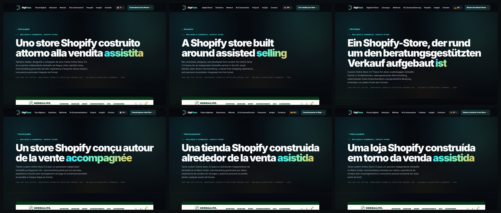
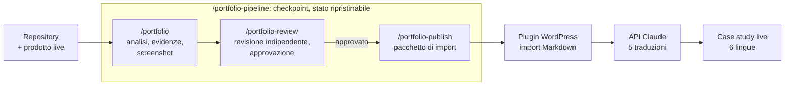

# Portfolio Pipeline

Da un repository di codice a un case study verificato, online su un sito WordPress in sei lingue.

Quattro skill di [Claude Code](https://claude.com/claude-code) e un plugin WordPress, costruiti in [DigiFluss](https://digifluss.com) per automatizzare la pagina che vende meglio il nostro lavoro ed era la più lenta da scrivere: il case study del portfolio.

[Read in English](README.md)


<sub>Un solo case study, scritto in italiano e tradotto dal plugin, online su digifluss.com in sei lingue.</sub>

## Il processo prima

Il 9 agosto 2026 abbiamo scritto il nostro primo case study ([Look And Feel Better](https://digifluss.com/progetti/look-and-feel-better/), un tema Shopify che abbiamo disegnato e sviluppato) guidando Claude Code con un prompt di 20 KB, un messaggio alla volta. Ci sono volute **2 ore e 47 minuti** e **7 messaggi di correzione e integrazione**. Tre aggiungevano fatti che sapevamo solo noi: il nostro ruolo, i tempi, il lavoro che nel codice non si vede. Quattro correggevano il risultato: togliere i trattini da testo scritto dall'AI (due volte), motivare le scelte di design, rifare gli screenshot, rinominare i file delle immagini.

Poi il testo doveva arrivare sul sito. Il nostro plugin WordPress accettava un case study un campo alla volta in wp-admin, solo in italiano, su un sito che parla sei lingue.

## Ogni correzione è diventata una regola

Non volevamo riscrivere quei sette messaggi per ogni progetto, così ognuno è entrato nel sistema:

| Cosa abbiamo dovuto dire il 9 agosto | Dove vive adesso |
| --- | --- |
| Il nostro ruolo, i tempi, il catalogo che abbiamo digitalizzato per il cliente | `CONTEXT.md`, un file che la pipeline legge come evidenza e non sovrascrive mai. I fatti mancanti tornano come domande, al massimo 7, mai come supposizioni |
| "Fai gli screenshot" | Fase 5 di `/portfolio`: liste di scatti per Playwright, ogni immagine aperta e controllata prima di tenerla |
| "Elimina i pattern da AI, come i trattini" (due volte) | `writing-rules.md` vieta trattini lunghi, catene di frecce e frasi fatte, e il revisore li cerca |
| "Motiva perché il verde e dove abbiamo messo gli accenti" | `quality-bar.md`: la sezione design dà a ogni colore un ruolo ed elenca dove compare |
| "Mostra i badge, i filtri, la barra degli annunci" | `screenshot-playbook.md`: da 4 a 7 scatti ravvicinati dei dettagli, perché l'artigianalità si vede da vicino |
| "Rinomina i file con il nome del progetto" | Ogni file ha come prefisso lo slug del progetto, così le gallerie non si sovrappongono |

Il giorno dopo i primi case study automatici sono usciti più sottili di quello fatto a mano. La soluzione è stata la stessa: il case study fatto a mano è diventato `quality-bar.md`, il livello minimo su cui ogni esecuzione viene controllata (almeno 15 evidenze, meccanismi descritti con i percorsi dei file, numeri contati, scatti ravvicinati).

La regola dei trattini doveva arrivare in un ultimo punto. Il 28 settembre ci siamo accorti che le traduzioni rimettevano i trattini (28 nella versione inglese di Look And Feel Better, 40 in quella di Frequency School), perché il prompt di traduzione non conteneva le nostre regole di scrittura. Dal plugin 1.11.7 le contiene, e le 15 traduzioni online sono state rifatte: non è rimasto nemmeno un trattino.

## Prima e dopo

| | Prima | Dopo |
| --- | --- | --- |
| I nostri messaggi dopo il primo comando | 7: tre fatti, quattro correzioni | 1: i fatti che avevamo solo noi |
| Tempo per un pacchetto finito | 2 h 47 min | 39 min, revisione indipendente compresa |
| Evidenze | citate nel testo della bozza, controllate da noi | un registro di 44 evidenze numerate con fonte e grado di certezza, ricontrollate da un revisore |
| Controllo qualità | noi, rileggendo la bozza | un agente revisore separato: 7 aree con punteggio, da 81/100 a 88 dopo le sue correzioni |
| Inserimento in WordPress | ogni campo scritto a mano in wp-admin | un'importazione Markdown compila 18 campi e i blocchi ripetibili; nulla viene salvato finché non premiamo Aggiorna |
| Lingue | italiano | italiano più cinque traduzioni con un clic, pubblicate solo se complete |

"Prima" è il nostro primo case study (9 agosto 2026) con il plugin precedente alla versione 1.7.0. "Dopo" è un'esecuzione della pipeline su un nuovo progetto interno (23 settembre 2026). Sono due progetti diversi, e la prima volta abbiamo anche dovuto inventare il metodo: i tempi sono indicativi, non un benchmark. Il cambiamento più netto è dove va il nostro tempo: prima a correggere bozze, ora a fornire fatti. Fonti e metodo: [docs/METRICS.md](docs/METRICS.md) (in inglese).

## Come funziona



**`/portfolio`** legge il repository (codice, schema, configurazione, storia git), controlla il prodotto online e costruisce un registro delle evidenze prima di scrivere qualsiasi testo. Ogni affermazione riceve un record numerato con la sua fonte (`code`, `runtime`, `git`, `user-context` e così via) e un grado di certezza. Quando le fonti non concordano, il prodotto funzionante vince sul codice e il codice sulla documentazione. Solo allora scrive `CASE-STUDY.md`, un `project.json` validato da uno schema e gli screenshot.

**`/portfolio-review`** passa il pacchetto a un agente separato che riceve solo i percorsi dei file e una checklist, mai il ragionamento di chi l'ha scritto, e quindi deve ricavare di nuovo i fatti dalle fonti. Assegna un punteggio a sette aree (accuratezza, evidenze, valore per il portfolio, profondità tecnica, racconto per immagini, scrittura, privacy), corregge ciò che si può correggere in sicurezza ed è l'unico passaggio che può impostare `approvedForPublish`. Su Frequency School ha scoperto che il peso della pagina indicato nella bozza ("circa 560 KB") non era riproducibile: il numero è stato tolto ovunque e sostituito con il peso di CSS e JavaScript del tema, che chiunque può controllare in DevTools.

**`/portfolio-publish`** non parte senza quell'approvazione. Studia il modello dei contenuti del sito di destinazione e ci adatta il pacchetto invece di costruire un sistema parallelo. Per il nostro sito WordPress produce un pacchetto di importazione: il file Markdown, le immagini nelle misure usate dal tema e la breve lista dei campi che restano manuali.

**Il plugin WordPress** legge il file Markdown direttamente nel browser e compila 18 campi più i blocchi ripetibili (design, capacità, approfondimenti tecnici). I valori ancora segnati `[da confermare]` vengono scartati apposta. Un pulsante di traduzione invia poi il case study all'API di Claude una volta per lingua, con barra di avanzamento e pulsante di stop. La richiesta usa l'output strutturato, con uno schema JSON ricavato dai campi del case study: la risposta è sempre leggibile e ha esattamente le chiavi italiane. Il prompt di traduzione contiene la stessa regola sui trattini dei testi italiani, e una lingua va online solo quando ogni campo italiano ha una traduzione completa. Le chiamate partono dal server, quindi la chiave non viene mai esposta ai visitatori del sito.

**`/portfolio-pipeline`** esegue i passaggi in ordine attraverso cinque checkpoint e tiene il suo stato in `.portfolio/pipeline.json`: un'esecuzione interrotta riprende dall'ultimo passaggio invece di ricominciare.

## Garanzie

- **Prima le evidenze.** Metriche di business, dimensione del team, tempi di sviluppo e il nostro ruolo non compaiono mai senza evidenza. Quando sono plausibili ma non verificati, diventano domande per noi.
- **L'ultima parola è delle persone.** `CONTEXT.md` (fatti) e `OVERRIDES.md` (decisioni editoriali) non vengono mai sovrascritti. Un override vince sull'automazione, a meno che non costringa a scrivere il falso.
- **La privacy viene filtrata due volte**, quando il pacchetto nasce e di nuovo subito prima della pubblicazione: niente credenziali, niente dati personali, niente URL interni, niente nomi di clienti segnati come riservati.
- **Mani lontane dalla produzione.** L'analisi non compra, non invia moduli e non modifica dati sul prodotto che studia. La pubblicazione scrive nel codice del sito o in un pacchetto di importazione; il deploy resta una decisione umana.

## Cosa resta manuale

- I fatti che sappiamo solo noi: il nostro ruolo, i tempi, se un cliente si può citare.
- Il titolo finale, il caricamento di copertina e galleria, pochi campi (obiettivo, integrazioni, colori di accento) e il pulsante Pubblica.
- L'avvio delle traduzioni, dalla scheda del progetto in wp-admin.

## Risultati finora

Tra il 9 agosto e il 28 settembre 2026:

- **8 progetti** analizzati dalla pipeline, con **424 evidenze numerate** in tutto (da 26 a 92 per progetto).
- **3 pacchetti approvati** dalla revisione indipendente: Frequency School (91/100), un'app Shopify interna (88/100) e TOPTOUR Portugal (69/100 al primo passaggio, approvato dopo le correzioni e la nostra conferma del sito definitivo).
- **Online su digifluss.com in sei lingue:** [Frequency School](https://digifluss.com/progetti/frequency-school/), [TOPTOUR Portugal](https://digifluss.com/progetti/toptour-portugal/) e il riferimento fatto a mano, [Look And Feel Better](https://digifluss.com/progetti/look-and-feel-better/). L'ultima tornata di traduzioni ha richiesto 15 chiamate e 26 minuti, tutte riuscite al primo colpo.

## Struttura del repository

```
skills/
  portfolio/            analisi, registro delle evidenze, screenshot, case study
  portfolio-review/     revisione indipendente, punteggi, approvazione
  portfolio-publish/    pubblicazione sul sito portfolio (codice o pacchetto di import)
  portfolio-pipeline/   orchestratore, riferimenti condivisi, schema JSON, template, script
wordpress-plugin/
  digifluss-portfolio/  tipo di contenuto "Progetti", importatore Markdown, traduzione AI, template
docs/
  METRICS.md            come è stato misurato ogni numero di questo README
```

## Come usarlo

Requisiti: Claude Code con skill e subagent, Python 3 con `playwright` per gli screenshot (usa il Chrome di sistema) e, facoltativo, `jsonschema` per la validazione.

```bash
git clone https://github.com/monellonasti/portfolio-pipeline.git
cp -r portfolio-pipeline/skills/* ~/.claude/skills/
pip install playwright jsonschema
```

Poi, dalla cartella principale di qualsiasi progetto:

```
/portfolio-pipeline https://example.com | Role: Full-stack developer | Year: 2026
```

Tutto ciò che segue il comando è contesto: gli URL vengono verificati e le coppie `Chiave: valore` compilano i campi del progetto. I case study sono in italiano salvo indicazione diversa (per esempio `Language: English`). Il primo `/portfolio-publish` chiede dove si trova il sito del portfolio e lo ricorda in `~/.claude/portfolio/config.json`. Dettagli in [skills/portfolio-pipeline/README.md](skills/portfolio-pipeline/README.md).

Il plugin WordPress è pensato per il tema DigiFluss e su altri temi usa stili propri. Le schermate di amministrazione sono in italiano. Copia `wordpress-plugin/digifluss-portfolio` in `wp-content/plugins/`, attivalo e inserisci una chiave API Anthropic in Portfolio > AI (stack) per abilitare le traduzioni.

## Licenza

Skill e documentazione: [MIT](LICENSE). Il plugin WordPress in `wordpress-plugin/` è GPL-2.0-or-later, come dichiarato nella sua intestazione.
