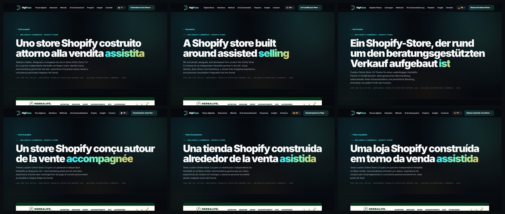
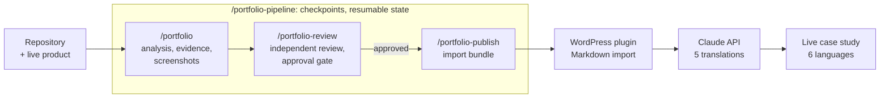

# Portfolio Pipeline

From a code repository to a verified case study, live on a WordPress site in six languages.

Four [Claude Code](https://claude.com/claude-code) skills and a WordPress plugin, built at [DigiFluss](https://digifluss.com) to automate the page that sells our work best and used to be the slowest to write: the portfolio case study.

[Leggi in italiano](README.it.md)


<sub>One case study, written in Italian and translated by the plugin, live on digifluss.com in six languages.</sub>

## The process before

On 9 August 2026 we wrote our first case study ([Look And Feel Better](https://digifluss.com/progetti/look-and-feel-better/), a Shopify theme we designed and built) by steering Claude Code through a 20 KB prompt, one message at a time. It took **2 h 47 min** and **7 follow-up messages**. Three of them added facts only we knew: our role, the timeline, work that never shows up in the code. Four corrected the output: remove the AI-sounding dashes (twice), explain the design choices, redo the screenshots, rename the image files.

Then the text had to reach the website. Our WordPress plugin took a case study one field at a time in wp-admin, in Italian only, on a site that speaks six languages.

## Every correction became a rule

We did not want to type those seven messages again for every project, so each one moved into the system:

| What we had to say on 9 August | Where it lives now |
| --- | --- |
| Our role, the timeline, the catalog we digitized for the client | `CONTEXT.md`, a file the pipeline reads as evidence and never overwrites. Missing facts come back as at most 7 questions, never as guesses |
| "Take the screenshots" | Phase 5 of `/portfolio`: Playwright shot lists, every image opened and checked before it is kept |
| "Remove the AI patterns, like the dashes" (twice) | `writing-rules.md` bans em dashes, arrow chains and stock phrases, and the reviewer checks for them |
| "Explain why green, and where the accents go" | `quality-bar.md`: the design section gives every color a role and lists where it appears |
| "Show the badges, the filters, the announcement bar" | `screenshot-playbook.md`: 4 to 7 close-up detail shots, because craft shows up close |
| "Rename the files with the project name" | Every file is prefixed with the project slug, so galleries never collide |

The next day the first automated runs came out thinner than the hand-made case study. The fix was the same move: the hand-made case study became `quality-bar.md`, the minimum every run is checked against (15+ evidence records, mechanisms named with file paths, counted numbers, close-up shots).

## Before and after

| | Before | After |
| --- | --- | --- |
| Our messages after the first command | 7: three facts, four corrections | 1: the facts only we had |
| Time to a finished package | 2 h 47 min | 39 min, independent review included |
| Evidence | cited inline in the draft, checked by us | a ledger of 44 numbered records with source and confidence, re-checked by a reviewer |
| Quality control | us, reading the draft | a separate reviewer agent: 7 scored areas, 81/100 raised to 88 by its fixes |
| Getting it into WordPress | every field typed in wp-admin | one Markdown import fills 18 fields and the repeatable blocks; nothing is saved until we press Update |
| Languages | Italian | Italian plus five translations in one click, published only when complete |

"Before" is our first case study (9 August 2026) and the plugin before version 1.7.0. "After" is a pipeline run on a new in-house project (23 September 2026). They are two different projects, and the first run also had to invent the method, so the times are indicative, not a benchmark. The clearer change is where our time goes: from correcting drafts to supplying facts. Sources and method: [docs/METRICS.md](docs/METRICS.md).

## How it works



**`/portfolio`** reads the repository (code, schema, configuration, git history), checks the live product, and builds an evidence ledger before writing any copy. Every claim gets a numbered record with its source (`code`, `runtime`, `git`, `user-context` and so on) and a confidence level. When sources disagree, the running product wins over the code, and the code over the docs. Only then does it write `CASE-STUDY.md`, a schema-validated `project.json` and the screenshots.

**`/portfolio-review`** hands the package to a separate agent that receives only the file paths and a checklist, never the creator's reasoning, so it has to re-derive the facts from the sources. It scores seven areas (accuracy, evidence, portfolio value, technical depth, visual story, copy, privacy), fixes what is safe to fix, and is the only step allowed to set `approvedForPublish`. On Frequency School it found that a page-weight figure in the draft ("about 560 KB") could not be reproduced: the number was removed everywhere and replaced with the weight of the theme's CSS and JavaScript, which anyone can check in DevTools.

**`/portfolio-publish`** refuses to run without that approval. It studies the target site's content model and maps the package onto it instead of building a parallel system. For our WordPress site it produces an import bundle: the Markdown file, the images at the sizes the theme uses, and the short list of fields that stay manual.

**The WordPress plugin** reads the Markdown file in the browser and fills 18 fields plus the repeatable blocks (design, capabilities, technical deep dives). Values still marked `[to confirm]` are skipped on purpose. A translate button then sends the case study to the Claude API once per language, with a progress bar and a stop button. The model has to return the same JSON structure, keys it invents are discarded, and a language goes live only when every Italian field has a complete translation. The calls start from the server, so the key is never exposed to the site's visitors.

**`/portfolio-pipeline`** runs the steps in order through five checkpoints and keeps its state in `.portfolio/pipeline.json`, so an interrupted run continues from its last step instead of starting over.

## Guardrails

- **Evidence first.** Business metrics, team size, development time and our role never appear without evidence. When they are plausible but unverified, they become questions for us.
- **People have the last word.** `CONTEXT.md` (facts) and `OVERRIDES.md` (editorial decisions) are never overwritten. An override beats the automation, unless it would force a false statement.
- **Privacy is filtered twice**, when the package is created and again right before publishing: no credentials, no personal data, no internal URLs, no client names flagged as confidential.
- **Hands off production.** The analysis never buys, submits forms or changes data on the product it studies. Publishing writes to the site's codebase or to an import bundle; deploying stays a human decision.

## What stays manual

- Facts only we know: our role, the timeline, whether a client can be named.
- The final title, the cover and gallery uploads, a handful of fields (goal, integrations, accent colors) and the Publish button.
- Starting the translations, from the project page in wp-admin.

## Results so far

Between 9 August and 23 September 2026:

- **8 projects** analyzed by the pipeline, with **424 numbered evidence records** in total (from 26 to 92 per project).
- **3 packages approved** by the independent review: Frequency School (91/100), an in-house Shopify app (88/100) and TOPTOUR Portugal (69/100 on the first pass, approved once its fixes were in and we had confirmed the live site).
- **Live on digifluss.com:** [Frequency School](https://digifluss.com/progetti/frequency-school/) and [TOPTOUR Portugal](https://digifluss.com/progetti/toptour-portugal/), in Italian so far, and the hand-made reference, [Look And Feel Better](https://digifluss.com/progetti/look-and-feel-better/), in six languages.

## Repository layout

```
skills/
  portfolio/            analysis, evidence ledger, screenshots, case study
  portfolio-review/     independent review, scoring, approval gate
  portfolio-publish/    publishing to the portfolio site (codebase or import bundle)
  portfolio-pipeline/   orchestrator, shared references, JSON schema, templates, scripts
wordpress-plugin/
  digifluss-portfolio/  "Progetti" post type, Markdown importer, AI translation, case study templates
docs/
  METRICS.md            how every number in this README was measured
```

## Using it

Requirements: Claude Code with skills and subagents, Python 3 with `playwright` for screenshots (it drives the system Chrome) and, optionally, `jsonschema` for validation.

```bash
git clone https://github.com/monellonasti/portfolio-pipeline.git
cp -r portfolio-pipeline/skills/* ~/.claude/skills/
pip install playwright jsonschema
```

Then, from the root of any project:

```
/portfolio-pipeline https://example.com | Role: Full-stack developer | Year: 2026
```

Everything after the command is context: URLs get verified and `Key: value` pairs fill project fields. Case studies are written in Italian by default; add `Language: English` to change that. The first `/portfolio-publish` asks where your portfolio site lives and remembers it in `~/.claude/portfolio/config.json`. More in [skills/portfolio-pipeline/README.md](skills/portfolio-pipeline/README.md).

The WordPress plugin is built for the DigiFluss theme and falls back to its own styles on other themes. Its admin screens are in Italian. Copy `wordpress-plugin/digifluss-portfolio` into `wp-content/plugins/`, activate it, and add an Anthropic API key under Portfolio > AI (stack) to enable translations.

## License

Skills and documentation: [MIT](LICENSE). The WordPress plugin in `wordpress-plugin/` is GPL-2.0-or-later, as declared in its header.
